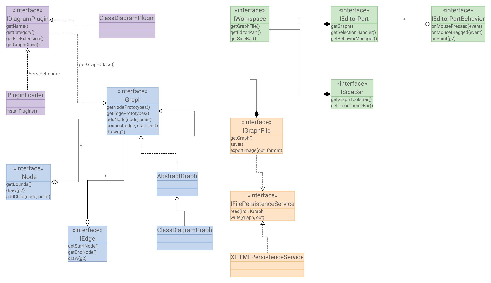

<p align="center">
  
</p>

<h1 align="center">Violet UML Editor</h1>

<p align="center">
  <b>Free, open-source and lightweight UML editor. Draw a diagram in seconds, on the desktop or in your browser.</b>
</p>

<p align="center">
  <a href="https://violetumleditor.github.io/product"><b>Open online</b></a> ·
  <a href="https://sourceforge.net/projects/violet/">Download desktop version</a> ·
  <a href="https://violetumleditor.github.io/">Website</a> ·
  <a href="https://violetumleditor.github.io/docs/">User guide</a> ·
  <a href="https://github.com/violetumleditor/product/issues">Report an issue</a>
</p>

<p align="center">
  
</p>


What is Violet?
===============

Violet is a UML editor written in Java (Swing) and designed to be **simple and fast**: pick an element in the side bar, drop it on the diagram, link it to another one. No project to configure, no model repository, no learning curve. It is the editor you open to sketch a design in a meeting, illustrate a course or document a piece of code.

+ **Six UML diagrams**: class, sequence, activity, state, object and use case.
+ **One JAR, two ways to run it**: as a desktop application (Windows, macOS, Linux), or **directly in a web browser** with nothing to install, thanks to [CheerpJ](https://cheerpj.com/).
+ **Diagrams are HTML files** (`*.violet.html`): anyone can open them in a browser to see the picture, and reopen them in Violet to edit them (see [below](#diagrams-are-html-files)).
+ **Touch friendly**: the same interface works with a mouse, a tablet or a phone.
+ Light and dark themes, English, French and German user interface, export to PNG and PDF, printing, undo/redo, auto-save.

Violet was originally created by Cay S. Horstmann and is distributed under the GNU General Public License, version 2 or later.


The workspace
=============


| # | Element | What it does |
|---|---------|--------------|
| 1 | **Menu bar** | File, Edit, View, Document and Help menus. On a narrow screen, all the menus collapse into a single "hamburger" menu. |
| 2 | **Diagram name** | Name of the active file. Click it to rename the diagram. |
| 3 | **Tool bar** | Undo/redo, cut/copy/paste, delete, zoom, light/dark theme switch, full screen. Buttons move into a "⋯" menu when space runs out. |
| 4 | **Tool search** | Type a few letters to filter the tools of the side bar. |
| 5 | **Common tools** | Elements available in every diagram (selection, note, free text, image, grouping area) and five generic links (line, arrow, double arrow, dotted, bent). |
| 6 | **Diagram tools** | Elements and UML relationships provided by the plugin of the active diagram (here: class, interface, package, dependency, inheritance…). |
| 7 | **Style** | Color palette and line thickness, applied to the selection. It also shows the style of the selected element. |
| 8 | **Side bar handle** | Collapses the side bar into a narrow rail of icons (done automatically under 1000 px wide). |
| 9 | **Graph (diagram canvas)** | The diagram itself: drag elements, draw a lasso, double-click (or double-tap) and drag to move the view, Ctrl + wheel to zoom. |
| 10 | **Selection buttons** | Around the selected element: the pencil opens its properties, the arrow draws a link to another element (or creates a new one where you release it). |

Other handy gestures: type on a selected element to rename it, use the arrow keys to move it, tap an empty spot then the "+" to add an element there.


Diagrams are HTML files
=======================

Violet saves every diagram as a single, self-contained **`.violet.html`** file (`.class.violet.html`, `.seq.violet.html`, `.activity.violet.html`, `.state.violet.html`, `.object.violet.html`, `.ucase.violet.html`). Such a file contains:

+ a **PNG picture** of the diagram, embedded in the page (base64 data URI), so that any browser displays it, with no plugin and no Violet installed;
+ the **diagram itself, as XML**, embedded in the same page (in a `<script type="text/xml">` block, shown by the "Toggle Embedded Source" button). This is what Violet reads when the file is reopened, so nothing is lost;
+ a small toolbar: **Open In Online Editor**, Toggle Embedded Source, Download Desktop Version.

You can send a diagram by e-mail, attach it to a ticket or commit it next to your code: the recipient sees it immediately, and it diffs reasonably well in Git. Files written by older versions of Violet are still read (backward compatibility is a hard requirement of the project).

Edit a diagram you received, in one click
-----------------------------------------

When you receive a `.violet.html` file, just open it in your browser and click **Open In Online Editor**. The page opens the online version of Violet (`https://violetumleditor.github.io/product`) in a new tab and **sends it the diagram** (file name, XML content and the whole HTML page) with the browser's `window.postMessage()` API. The editor checks the origin of the message, acknowledges it, stores the diagram in its own browser storage and opens it, ready to edit. Nothing is uploaded to a server: the transfer happens between the two tabs of your browser. (If messages are filtered, the diagram is passed through `window.name` instead.)

The implementation lives in [`XHTMLFileTemplate.violet.html`](violet-framework/src/main/java/com/horstmann/violet/framework/file/persistence/XHTMLFileTemplate.violet.html) (sender, template of every saved file) and [`web/index.html`](violetproduct-swing/src/main/resources/web/index.html) (receiver).

> Try it: [`framework.class.violet.html`](docs/images/framework.class.violet.html), the class diagram below, is such a file. Download it, open it in your browser, and click **Open In Online Editor**.


The framework
=============

Violet is split into a generic **framework** (`violet-framework`) and **one plugin per diagram type**. The framework knows nothing about classes, lifelines or activities: it handles graphs made of nodes and edges, their display and editing, the files and the user interface. The class diagram below, drawn with Violet itself, shows its main abstractions.



+ **Model** (blue, package `com.horstmann.violet.product.diagram.abstracts`): an `IGraph` holds `INode`s and `IEdge`s and draws itself. `AbstractGraph`, `AbstractNode` / `RectangularNode` / `EllipticalNode` and `AbstractEdge` / `SegmentedLineEdge` do most of the work, so a diagram type only describes its own shapes and rules. Elements shared by all diagrams (note, free text, image, grouping area, generic link) are in `product.diagram.common`.
+ **Workspace** (green, package `com.horstmann.violet.workspace`): an `IWorkspace` is one open diagram. It combines the `IEditorPart` (the canvas), the `ISideBar` (tools built from the node and edge prototypes of the graph) and the `IGraphFile`. Every interaction on the canvas (select, drag, add a node, draw a link, undo, auto-save…) is a separate `IEditorPartBehavior` plugged into the editor part.
+ **Files** (orange, package `com.horstmann.violet.framework.file`): an `IGraphFile` reads and writes its graph through an `IFilePersistenceService`. The default one, `XHTMLPersistenceService`, writes the `.violet.html` format described above. File dialogs go through `IFileChooserService`, with one implementation for the desktop and one for the browser.
+ **Plugins** (violet): see next section.

The framework also brings its own small dependency injection engine ("Manioc": `@ManagedBean`, `@InjectedBean`, `BeanInjector`), themes (FlatLaf light and dark), property editors and internationalization (`.properties` files next to the Java sources).


Plugin architecture
===================

Each diagram type is a Maven module that depends only on the framework:

```
violet-framework                    core: model, workspace, files, plugin loader
violetplugin-classdiagram           ┐
violetplugin-sequencediagram        │
violetplugin-activitydiagram        │  one plugin per diagram type
violetplugin-statediagram           │
violetplugin-objectdiagram          │
violetplugin-usecasediagram         ┘
violetproduct-swing                 the application: menus, main window, browser bridge, fat JAR
violetproduct-exe / -deb            installers (Windows / Debian)
```

A plugin contains:

1. **An `IDiagramPlugin` implementation** giving the diagram name, its menu category, its file extension and its graph class. For instance `ClassDiagramPlugin` returns `ClassDiagramGraph.class` and the `.class.violet.html` extension.
2. **A graph class** (`ClassDiagramGraph extends AbstractGraph`) that declares the **node and edge prototypes** shown in the side bar, and the **connection rules** (which UML relationship may go from which element to which element: a class implements an interface, but never inherits from it).
3. **Node and edge classes** (`ClassNode`, `InterfaceNode`, `InheritanceEdge`…) that draw themselves, plus their `.properties` files for tooltips and labels.
4. **A service declaration**: the file `src/main/resources/META-INF/services/com.horstmann.violet.framework.plugin.IDiagramPlugin` lists the plugin class.

At startup, `PluginLoader` discovers every plugin on the classpath with the standard Java `ServiceLoader` and registers it in the `PluginRegistry`. The "File > New" menu, the file filters and the side bar are then built from the registered plugins. Adding a new diagram type therefore needs **no change in the framework**: create a module modeled on an existing plugin, and add it to the root `pom.xml` and to the dependencies of `violetproduct-swing`. When packaging the fat JAR, the Maven Shade plugin merges the service files of all plugins (`AppendingTransformer`), so that they all load.


How to compile Violet's source code
===================================

Prerequisites:

+ **Java Development Kit 17** or greater (the bytecode targets Java 17; CI builds with JDK 21)
+ **Maven 3** or greater

From the root directory:

```bash
git clone https://github.com/violetumleditor/product.git
cd product
mvn clean package
```

This compiles every module, runs the tests and packages everything. Each module puts its result in its own `target` directory, for example:

+ `violetproduct-swing/target/violetumleditor-<version>.jar`: the application (a single runnable JAR with all plugins)
+ `violetproduct-exe/target/violetumleditor-<version>.exe`: the Windows executable
+ `violetproduct-deb/target/*.deb`: the Debian package

To build and run only the application:

```bash
mvn clean package -pl violetproduct-swing -am
java -jar violetproduct-swing/target/violetumleditor-<version>.jar
```

Useful launch options: `-english` (force English), `-theme=light|dark`, `-file=<path>` (open a diagram), `-reset` (clear the preferences), `-help`.

Test the browser version (CheerpJ) without packaging
----------------------------------------------------

The online version runs the very same Swing application in the browser with CheerpJ (see `violetproduct-swing/src/main/resources/web/index.html`). While developing, you can run your local code the same way, from your file system, with no web server:

1. From the root directory, run `mvn compile -Pcheerpj-test`. Besides compiling, this profile generates `violetproduct-swing/target/cheerpj-test/bundle.js`, which contains the compiled classes of every module and all the third-party jars.
2. Open `violetproduct-swing/src/main/resources/web/test.html` in your browser (double-click it, or use a `file://` URL). An internet connection is required to download the CheerpJ runtime.
3. After each change in the Java code, run step 1 again, then reload the page.

Notes:
+ Always run the command from the root directory. From `violetproduct-swing` alone, Maven would use previously installed framework and plugin jars instead of your current code.
+ Compiling from your IDE is not enough: the bundle is only refreshed by the Maven command.
+ `test.html` is a copy of `index.html` that only differs by the way it starts the application. When you change the JavaScript bridge (native functions) in `index.html`, report the change in `test.html`.

How files are handled in the browser version
--------------------------------------------

In the browser, diagrams are kept in the browser's own storage (CheerpJ's `/files` directory, stored in IndexedDB). They survive a page reload, but they are tied to this browser and this site.

+ New diagrams are auto-saved 2 seconds after the last change, then show up in File > Recent files.
+ File > Open lists the diagrams kept in the browser, most recent first; the trash icon (or the Delete key) removes one.
+ File > Import from > Diagram file loads a diagram from your computer; File > Export to > Diagram file downloads the current one.


How to contribute
=================

**Please do not open pull requests: they will not be merged.** Violet is maintained by a single developer who integrates every change by hand.

Contributions are very welcome as **[issues](https://github.com/violetumleditor/product/issues)**:

+ **Bug report**: what you did, what you expected, what happened, your version of Violet, and whether you use the desktop or the online version (with your browser). Attach the `.violet.html` file when a diagram is involved, it is the quickest way to reproduce the problem.
+ **Feature request**: describe your need and, if possible, the use case behind it. A mockup or a screenshot helps a lot.

Every issue is read, and the good ideas end up in the next version.


Kind regards,
Alex
